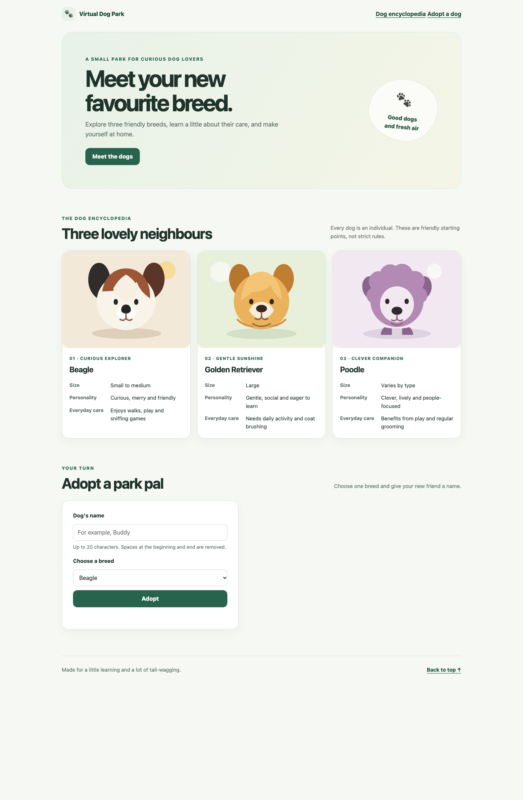

# Virtual Dog Park

A small, beginner-friendly dog encyclopedia and virtual pet website for the AIE1101 Week 5 visual lab. The project uses plain HTML, CSS and JavaScript without a framework or backend; all illustrations are stored locally.

## Features

- An encyclopedia for Beagles, Golden Retrievers and Poodles
- Three original SVG illustrations stored locally in the assets folder
- A form to adopt one dog with a name of up to 20 characters
- Feed and Play actions that increase happiness by 10, up to 100
- Simulated days and visible Puppy, Young Dog and Adult Dog stages
- Browser storage that restores one dog's progress after refresh
- A confirmed Start Over action that clears saved progress only after confirmation
- A responsive layout for laptop and narrow phone screens

## Preview

Open this folder in Visual Studio Code, install the Live Server extension, then right-click index.html and choose Open with Live Server. Use the same browser and local server address while checking saved progress.

The SVG illustrations were created for this project. They are illustrations, not real dog photographs.

## Growth and happiness rules

- A new dog starts on Day 1 as a Puppy with happiness 50.
- Days 2 and 3 are Young Dog. Day 4 onward is Adult Dog.
- Feed and Play add 10 happiness per click, up to 100.
- Next Day adds one day and subtracts 5 happiness, down to 0.
- The dog name is trimmed, must not be blank, and is limited to 20 characters.
- Saved progress uses the browser's localStorage key virtualDogParkPetV1. It stays in the same browser on the same device; it is not stored in a GitHub account.
- Start Over asks for confirmation. Cancel keeps the dog; Confirm clears the saved dog.

## Checks performed

- [x] The three breed cards and all three local illustrations appear.
- [x] An empty or spaces-only dog name is rejected.
- [x] Spaces at the ends of a name are trimmed; a name containing < and > displays as text.
- [x] A 20-character name can be used and longer typing is limited.
- [x] Feed and Play each add 10 happiness; happiness stops at 100.
- [x] Day 2 shows Young Dog; Day 4 shows Adult Dog; happiness does not fall below 0.
- [x] Refresh restores the pet's name, breed, day and happiness.
- [x] Start Over + Cancel keeps the dog; Start Over + Confirm clears the saved dog and resets the form.
- [x] At a 390-pixel phone width, the breed cards use one column and the page has no horizontal overflow.

## Reflection draft

See [reflection-draft.md](reflection-draft.md). Please edit its personal-learning sentence to match your own experience before submitting.
